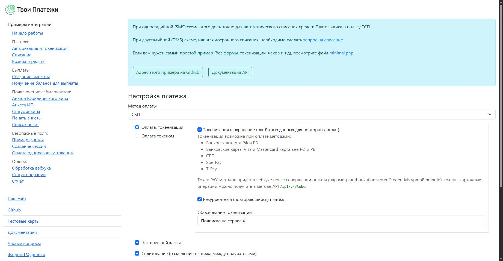

# «Твои Платежи»: Интеграция на PHP
Готовая библиотека PHP API Client для YourPayments + примеры с комментариями


## Оглавление
- [Описание](#описание)
- [Требования](#требования)
- [Установка](#установка)
  - [Запуск встроенного сервера](#запуск-встроенного-сервера)
  - [Запуск в контейнере docker](#запуск-в-контейнере-docker)
- [Примеры использования](#примеры-использования)
  - [Начало работы: настройка интеграции](#1-начало-работы-настройка-интеграции)
  - [Приём платежей](#2-приём-платежей)
  - [Подписки](#3-подписки) (рекуррентные платежи)
  - [Токенизация](#4-токенизация) (запомнить данные плательщика, чтобы не запрашивать и не вводить их повторно)
  - [Отчёты и статусы платежей](#5-отчёты)
  - [Возврат средств плательщику](#6-возврат-средств-плательщику-refund) (refunds, рефанды)
  - [Выплаты](#7-выплаты) (отправка денег по номеру карты или телефона)
  - [Подключение продавцов](#8-подключение-продавцов)
  - [Обработка вебхуков](#9-обработка-вебхуков)
  - [Страница после оплаты](#10-страница-после-оплаты)
  - [Безопасные поля](#11-безопасные-поля-secure-fields) (отдельный вид интеграции карточной формы)
  - [Обработка ошибок](#12-обработка-ошибок)
- [Настройка HTTP-клиента](#настройка-http-клиента)
  - [Опции cURL: таймауты, прокси, сертификаты](#опции-curl-таймауты-прокси-сертификаты)
  - [Собственные заголовки запроса](#собственные-заголовки-запроса)
  - [Журнал запросов (PSR-3)](#журнал-запросов-psr-3)
  - [Код ответа и заголовки ответа](#код-ответа-и-заголовки-ответа)
- [Запуск тестов](#запуск-тестов)
- [Обновление библиотеки](#обновление)
- [Поддержка и контакты](#ссылки-поддержка-и-контакты)

## Описание
`yourpayments/php-api-client` — это PHP библиотека для быстрой и удобной интеграции с платежным шлюзом YourPayments. 
С её помощью можно принимать оплаты и создавать выплаты, получать  отчёты, делать возвраты и работать с подпискам.

Библиотека ориентирована на простое и надёжное использование, подходит как для опытных, так и для начинающих разработчиков.

Пример быстрого старта для приёма платежей:
```php
$merchant = new Merchant('MERCHANT_CODE', 'SECRET_KEY'); // Коды подключения API
$merchantPaymentReference = 123; // Номер заказа в вашей системе
$billing = (new Billing)
  ->setCountryCode('RU') // Страна Плательщика
  ->setFirstName('Иван') // Имя Плательщика
  ->setLastName('Петров') // Фамилия Плательщика
  ->setEmail('test1@ypmn.ru') // Почта Плательщика
  ->setPhone('+74996492009') // Телефон Плательщика
  ->setCity('Москва');  // Город Плательщика
  
$client = (new Client)->setBilling($billing);
$payment = (new Payment)
  ->addProduct(new Product([
    'name'  => 'Заказ №' . $merchantPaymentReference, // Наименование товарной позиции
    'sku'  => 'test_artikul', // Артикул
    'unitPrice'  => 20.42, // Стоимость единицы
    'quantity'  => 1, // Количество
]));
$payment_method = $_GET['method'] ?? PaymentMethods::CCVISAMC; // Определим платёжный метод
$authorization = new Authorization($payment_method, true);
$payment->setAuthorization($authorization);
$payment->setMerchantPaymentReference($merchantPaymentReference);
$payment->setSuccessUrl('https://' . $_SERVER['HTTP_HOST'] . '/?status=success'); // Редирект после успешной оплаты
$payment->setFailUrl('https://' . $_SERVER['HTTP_HOST'] . '/?status=success'); // Редирект в случае неоплаты
$payment->setClient($client);

$apiRequest = new ApiRequest($merchant);
$responseData = $apiRequest->sendAuthRequest($payment, $merchant);
$responseData = json_decode((string) $responseData["response"], true); // Отправка запроса и обработка ответа
if (isset($responseData["paymentResult"])) {
    if (!empty($responseData['paymentResult']['bankResponseDetails']['customBankNode']['qr'])) {
        $qr = $responseData['paymentResult']['bankResponseDetails']['customBankNode']['qr'];
    }

    // Выведем кнопку оплаты (рекомендуется)
    echo Std::drawYpmnButton([
        'qr' => ($qr ?? null),
        'url' => $responseData['paymentResult']['url'] ?? '',
        'sum' => $payment->sumProductsAmount() ?? 0,
        'payment_method' => $payment_method ?? null,
        'newpage' => true,
    ]);

    // .. или сделаем редирект на форму оплаты (опционально)
    // Std::redirect($responseData["paymentResult"]['url']);
}
```

Особенностями системы являются:
- мульти-эквайринг (работа сразу со многими банками, переключение в случае недоступности)
- поддержка сплитования (разделение одного платежа на несколько получателей платежа, в рамках одного чеке)
- безопасность и точность расчётов

Библиотека содержит:
- Клиент для работы с API платежей, выплат, отчётов
- Простой встроенный сервер с примерами
- Описание контейнера для запуска в Docker

---

## Требования

- PHP 7.4 и выше (рекомендуется PHP 8.1+)
- Расширения PHP: `curl`, `json`, `mbstring`
- Рекомендуется: Composer для управления зависимостями

---

## Установка
Установка с [пакета composer](https://packagist.org/packages/yourpayments/php-api-client) -- самый простой и рекомендуемый способ:

```shell
composer require yourpayments/php-api-client
```

Если на вашем проекте нет Composer, 
склонируйте или скачайте, а затем подключите файлы этого репозитория, 
([пример](src/Examples/autoload.php)) 

### Запуск встроенного сервера
```shell
php -S localhost:8080 index.php
```

После запуска по адресу http://localhost:8080 будут доступны интерактивные примеры в следующем виде:



### Запуск в контейнере docker
Создайте и запустите docker контейнер следующей командой:
```shell
docker compose up
```

Либо в фоновом режиме командой:
```shell
docker compose up --detach
```
После выполнения сервис с документацией и примерами будет доступен по адресу http://localhost:8080/

---
 
## Примеры использования:
##### 1. [Начало работы: настройка интеграции](src/Examples/start.php)

##### 2. Приём платежей
1. [Платёж, токенизация, чеки](src/Examples/authorize.php)
1. [Минимальная установка](src/Examples/minimal.php)
1. [Списание средств (только для двустадийной оплаты)](src/Examples/paymentCapture.php) 

##### 3. Подписки
Рекуррентные платежи
1. [Создание подписки СБП](src/Examples/getBindingFasterPayment.php)
1. [Оплата по подписке СБП](src/Examples/paymentByFasterBinding.php)
1. [Создание подписки SberPay, T-Pay, Картой не РФ](src/Examples/getBindingPays.php)
1. [Оплата по подписке SberPay, T-Pay, Картой не РФ](src/Examples/paymentByBindingPays.php)
   
##### 4. Токенизация
Запомнить данные клиента, чтобы не запрашивать и не вводить их повторно
1. [Создание платёжного токена ](src/Examples/getToken.php)
2. [Оплата токеном](src/Examples/paymentByToken.php)
  
##### 5. Отчёты
1. [Проверка статуса платежа](src/Examples/paymentGetStatus.php)
2. [Запрос детального отчета по заказу](src/Examples/getReportOrderDetails.php)
3. [Запрос быстрого отчёта по заказам для сверки](src/Examples/getReportOrder.php)
4. [Запрос отчёта по заказам](src/Examples/getReportGeneral.php)
5. [Запрос отчёта в виде графика](src/Examples/getReportChart.php)

##### 6. Возврат средств плательщику (Refund)
1. [Возврат средств](src/Examples/paymentRefund.php)
2. [Возврат средств со сплитом (разделением платежа)](src/Examples/paymentRefundMarketplace.php)

##### 7. Выплаты
1. [Выплаты на банковские карты](src/Examples/payout.php)
2. [Запрос баланса для выплаты](src/Examples/payoutGetBalance.php)

##### 8. Подключение продавцов
Добавление сабмерчантов маркетплейсов по API
1. [Подключение продавца-юридического лица (отправка анкеты)](src/Examples/qstCreateOrg.php)
2. [Подключение продавца-ИП (отправка анкеты)](src/Examples/qstCreateIp.php)
3. [Получение статуса анкеты](src/Examples/qstStatus.php)
4. [Печать анкеты](src/Examples/qstPrint.php)
5. [Список анкет](src/Examples/qstList.php)

##### 9. [Обработка вебхуков](src/Examples/webhookProcessing.php)
Вебхуки -- HTTP запросы, оповещающие ваш сервер о событиях (успешные и неуспешные оплаты, списания) 

##### 10. [Страница после оплаты](src/Examples/returnPage.php)

##### 11. [Безопасные поля (Secure fields)](src/Examples/secureFields.php)
2. [Создание сессии](src/Examples/getSession.php)
3. [Оплата одноразовым токеном](src/Examples/oneTimeTokenPayment.php)

##### 12. Обработка ошибок
Библиотека выбрасывает один вид исключений: [Ypmn\PaymentException](/src/PaymentException.php).

Пример перехвата исключения можно посмотреть в примере: [Cамый простой платёж](src/Examples/simpleGetPaymentLink.php)

---

## Настройка HTTP-клиента

### Опции cURL: таймауты, прокси, сертификаты
Любую опцию cURL можно переопределить -- она применяется поверх значений SDK по умолчанию
(соединение -- 10 секунд, ответ на GET -- 30 секунд, на POST и PUT -- 60 секунд):

```php
$apiRequest = new ApiRequest($merchant);

$apiRequest
    ->setCurlOption(CURLOPT_CONNECTTIMEOUT, 3)
    ->setCurlOption(CURLOPT_TIMEOUT, 15);

// или несколько опций сразу
$apiRequest->setCurlOptions([
    CURLOPT_PROXY => 'http://proxy.example.com:3128',
    CURLOPT_CAINFO => '/etc/ssl/certs/ca-certificates.crt',
]);
```

Опции, от которых зависят подпись запроса и разбор ответа (`CURLOPT_URL`, `CURLOPT_CUSTOMREQUEST`,
`CURLOPT_POSTFIELDS`, `CURLOPT_HTTPHEADER`, `CURLOPT_RETURNTRANSFER`, `CURLOPT_HEADER`,
`CURLOPT_HEADERFUNCTION`), переопределить нельзя -- будет выброшено `PaymentException`.

### Собственные заголовки запроса
```php
$apiRequest->setHeader('X-Request-Id', $requestId);
$apiRequest->setHeaders(['X-Trace-Id' => $traceId, 'X-Shop-Version' => '2.4.1']);
$apiRequest->removeHeader('X-Trace-Id');
```

Заголовки отправляются со всеми последующими запросами этого объекта. Имя заголовка сравнивается без учёта
регистра, а перевод строки в имени или значении приводит к `PaymentException`. Заголовки подписи
(`X-Header-Date`, `X-Header-Merchant`, `X-Header-Signature`, `X-Header-Idempotency-Key`), а также `Accept` и
`Content-Type` SDK выставляет сам для каждого запроса, поверх пользовательских.

### Журнал запросов (PSR-3)
Режим отладки `setDebugMode()` выводит HTML на страницу и предназначен только для примеров.
Для рабочего окружения подключите любой логгер [PSR-3](https://www.php-fig.org/psr/psr-3/) (Monolog, логгер Laravel или Symfony):

```php
$apiRequest->setLogger($logger);
```

| Событие | Уровень | Что в контексте |
|---|---|---|
| Запрос отправляется | `debug` | `request_id`, `method`, `url`, `headers`, `body` |
| Получен ответ 1xx-3xx | `info` | `request_id`, `http_code`, `duration_ms`, `connect_time_ms`, `primary_ip`, `headers`, `body` |
| Получен ответ 4xx | `warning` | то же |
| Получен ответ 5xx или запрос не дошёл | `error` | то же и `curl_errno`, `curl_error` |

- `request_id` связывает записи о запросе и об ответе.
- Номер карты, CVV, срок действия, токены, подпись запроса и cookie в журнал не попадают: значения заменяются на `***`.
  Список скрываемых полей JSON -- `LogSanitizer::DEFAULT_SENSITIVE_FIELDS`, заменить его можно через `setLogSensitiveFields()`.
- Тела длиннее 10 000 символов обрезаются (`setLogBodyMaxLength()`), а `setLogBodies(false)` исключает тела из журнала полностью.
- Сбой самого логгера не прерывает запрос к платёжному шлюзу.

Пакет `psr/log` нужен, только если вы вызываете `setLogger()`; без него SDK работает как раньше.

### Код ответа и заголовки ответа
Методы отправки запросов возвращают, помимо `response` и `error`, код ответа HTTP и заголовки ответа:

```php
$result = $apiRequest->sendStatusRequest($merchantPaymentReference);

$result['httpCode']; // 200
$result['headers'];  // ['HTTP/1.1 200 OK', 'Content-Type: application/json', ...]
```

## Запуск тестов
```shell
composer install
composer test
```

## Обновление

Обновления библиотеки позволяют быстро исправлять ошибки и получать доступ к новым функциям

```shell
composer update yourpayments/php-api-client
```

---

## Ссылки, поддержка и контакты
- [НКО «Твои Платежи»](https://YPMN.ru/?utm_source=php-api-client)
- [Докуметация API](https://ypmn.ru/doc/?utm_source=php-api-client)
- [Тестовые банковские карты](https://ypmn.ru/doc/?utm_source=php-api-client#tag/testing)
- [FAQ, ответы на частые вопросы](https://ypmn.ru/ru/support/?utm_source=php-api-client)
- [Задать вопрос или сообщить о проблеме](https://github.com/yourpayments/php-api-client/issues/new)

---
🟢 [«Твои Платежи»](https://YPMN.ru/ "Платёжная система для сайтов, платформ и приложений") -- финтех для сайтов, платформ и приложений
